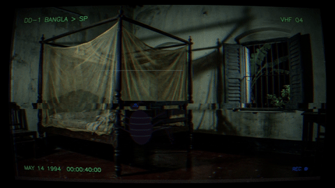
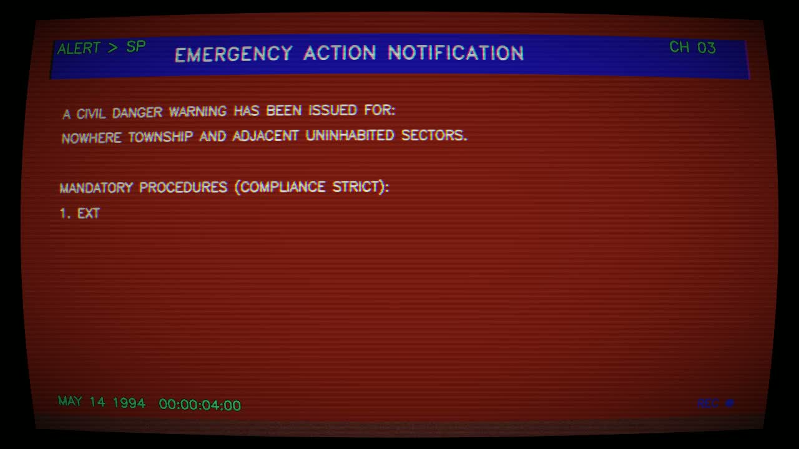
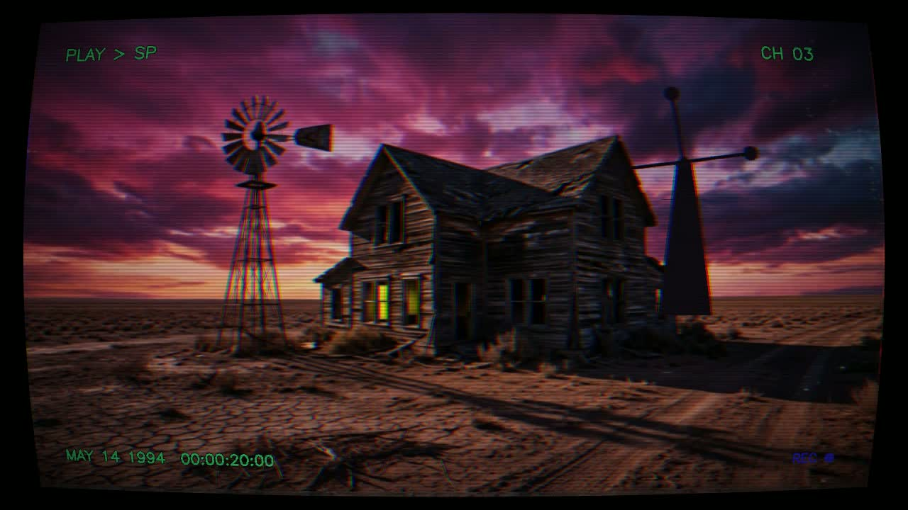
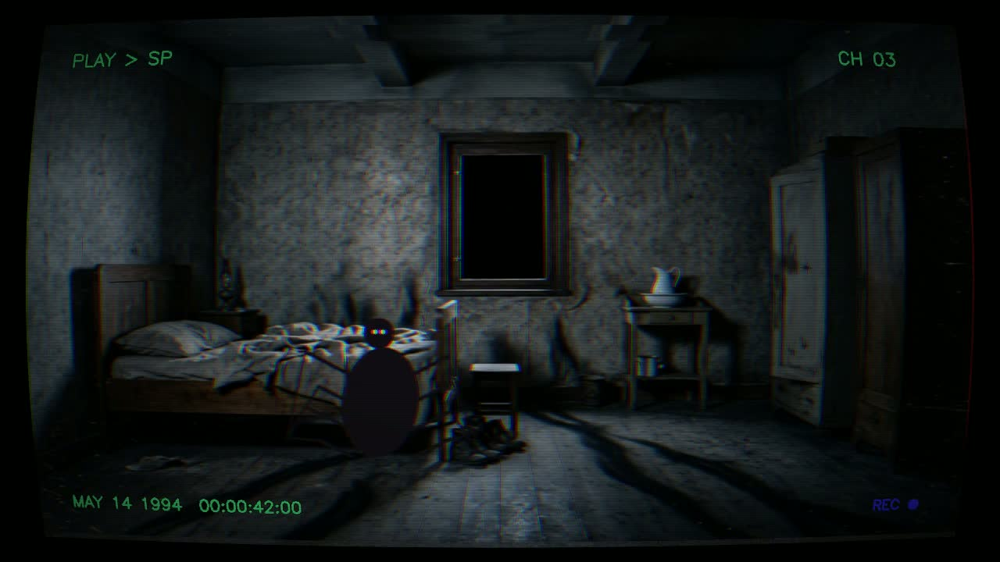
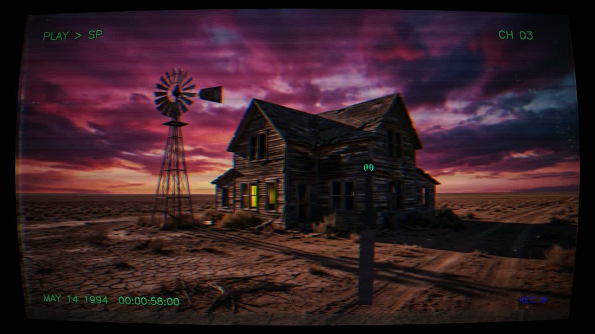

# PROJECT NOIR — Autonomous Analog Horror Cinema Engine

[](https://colab.research.google.com/github/sayan-bhattacharya/noir-analog-horror/blob/main/colab_noir_accelerator.ipynb)


An Alex Kister style psychological analog horror film engine set to the subterranean drone track *"Noir"* by Atandra (DroneWatch). 

Synthesizing **Kafka's *The Metamorphosis***, **Lovecraftian cosmic dread**, **television white noise as an intelligent entity**, and the surreal desolate world of ***Courage the Cowardly Dog***.

---

## 📺 The 10M-View YouTube Hook

Analog horror hooks rely on shattering institutional trust within the first 5 seconds:

```
====================================================
FEDERAL EMERGENCY BROADCAST SYSTEM — BULLETIN #404
====================================================
COUNTY OF NOWHERE — MANDATORY TRANSMISSION

1. DO NOT ATTEMPT TO INSPECT YOUR BASEMENT.
2. DO NOT COMMUNICATE WITH DOMESTIC ANIMALS.
3. IF YOU AWAKEN TO FIND ADDITIONAL LIMBS
   EMERGING BENEATH YOUR RIBS:
   DO NOT RESIST THE CHITIN. REMAIN FACING THE WALL.
4. DO NOT LOOK UPON THE CELESTIAL EYE.

THIS TRANSMISSION WILL REPEAT UNTIL TERMINATION.
====================================================
```

---

## 🎬 Visual Showcase & Preview



> *Featuring authentic 1994 EAS broadcast headers, real-time CRT barrel distortion, horizontal tracking tearing, stickman Gregor Samsa arachnid metamorphosis, and the surreal Courage the Cowardly Dog Nowhere farmhouse.*

---

## 🖼️ Milestone Visual Gallery

| Scene 01 — Emergency Action Notification (EAN) | Scene 02 — The Nowhere Farmhouse & Windmill |
|:---:|:---:|
|  |  |
| **Scene 03 — Kafka's Chitinous Metamorphosis** | **Scene 04 — The Surreal Nowhere Cat on Fence** |
|  |  |

---

```
                     ┌──────────────────────────────────────────────┐
                     │            PROJECT NOIR AESTHETIC            │
                     └──────────────────────┬───────────────────────┘
                                            │
         ┌──────────────────┬───────────────┴───────────────┬──────────────────┐
         ▼                  ▼                               ▼                  ▼
  [KAFKA'S METAMORPHOSIS] [LOVECRAFTIAN COSMIC DREAD] [COURAGE THE COWARDLY DOG] [TELEVISION WHITE NOISE]
  Gregor Samsa waking up  Unfathomable entities      Lone crooked farmhouse in   The static is not empty;
  with vermin chitin,     whispering through         "Nowhere", creaking         it is breathing. The
  scurrying limbs, and    cosmic carrier waves       windmill, surreal violet    broadcast summons what
  alienation in bedroom   and non-Euclidean skies    twilight, shadow horrors    sleeps beneath the floor
```

1. **Kafka's *The Metamorphosis***:
   - Stickman Gregor Samsa waking up on an austere hardwood bedroom floor.
   - Needle-thin, multi-jointed chitinous arachnid limbs erupting from his torso with stop-motion jitter.
   - Scurrying spider swarms crawling across the camera lens.
2. ***Courage the Cowardly Dog* Surrealism**:
   - The crooked, lonely wooden farmhouse in the flat wasteland of "Nowhere".
   - An iron windmill with bent, missing blades creaking against a toxic violet and bruised magenta twilight.
   - An uncanny black cat sitting on a fence post whose neck stretches hundreds of feet into the sky.
3. **Lovecraftian Cosmic Dread**:
   - The lunar disc peeling open like a colossal eyelid, revealing a hyper-detailed, bloodshot human optic pupil staring down at the earth.
4. **Television White Noise as an Entity**:
   - Real-time analog static snow, curved CRT barrel glass distortion, phosphor scanlines, chromatic aberration ($R/B$ channel split), and bottom head-switching VHS tracking noise.

---

## ⚡ Real-Time Procedural Analog Horror Shaders

All video processing is implemented in pure Python, OpenCV, and NumPy for extreme throughput:

- **CRT Spherical Curvature**: Non-linear barrel distortion simulating 1980s curved glass Zenith monitors.
- **Phosphor Scanlines**: Horizontal alternating cathode beam decay.
- **VCR Tracking Tear**: Sub-bass reactive horizontal scanline displacement and bottom 24px head-switching noise.
- **Chromatic Aberration**: Dynamic RGB separation triggered by subterranean low-frequency transients.
- **VCR OSD (On-Screen Display)**: Classic phosphor green tracking timestamps (`PLAY ▶ SP`, `CH 03`, `MAY 14 1994`).

---

## 🚀 How to Run

### Option A: 1-Click Cloud GPU on Google Colab (Recommended)
1. Click the **[Open in Colab](https://colab.research.google.com/github/sayan-bhattacharya/noir-analog-horror/blob/main/colab_noir_accelerator.ipynb)** badge.
2. Select **Runtime -> Change runtime type -> T4 GPU**.
3. Run all cells (`Ctrl + F9`). The engine renders the 720p story master with synced audio and downloads the file automatically.

### Option B: Local Execution

```bash
# 1. Clone the repository
git clone https://github.com/sayan-bhattacharya/noir-analog-horror.git
cd noir-analog-horror

# 2. Install lightweight dependencies
pip install opencv-python soundfile scipy pillow

# 3. Render 720p Analog Horror Story Master
python -m noir_film.render_noir 75
```

---

## 📜 Credits
- **Track**: *"Noir"* by Atandra (DroneWatch)
- **Engine Architecture**: Google Antigravity & Between The Notes Studio
- **License**: MIT
