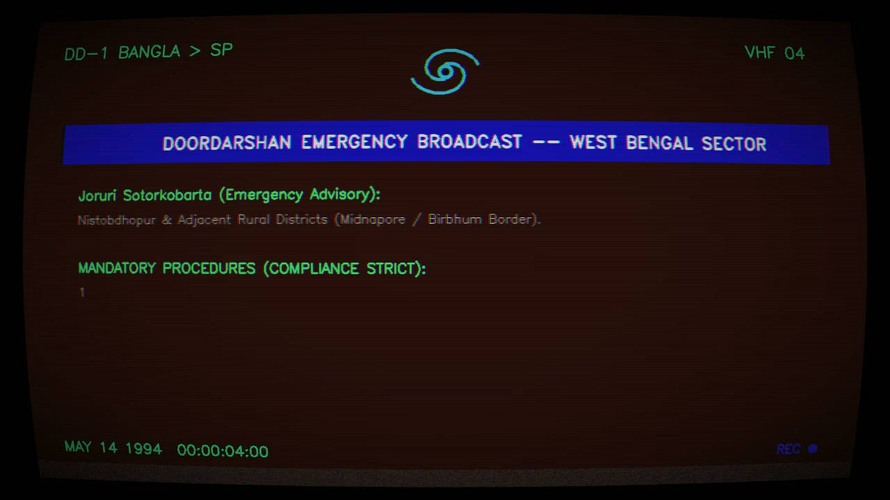
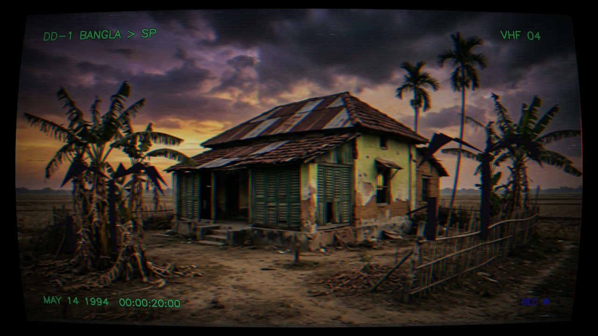
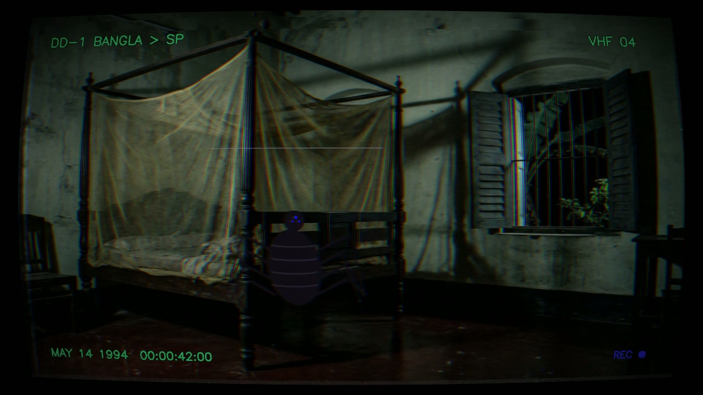
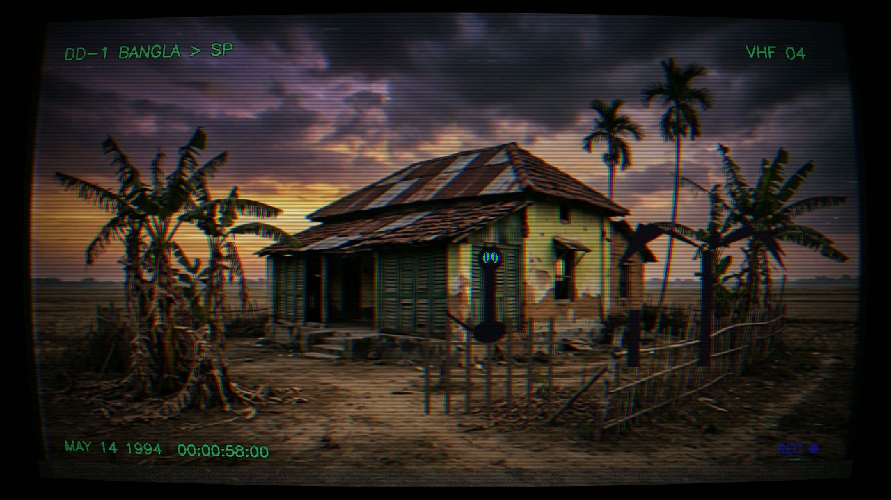

# PROJECT NOIR — Autonomous Analog Horror Cinema Engine
### নিশিডাক (THE NISHIDAK BROADCAST) — Rural Bengal Analog Horror

[](https://colab.research.google.com/github/sayan-bhattacharya/noir-analog-horror/blob/main/colab_noir_accelerator.ipynb)


An Alex Kister style psychological analog horror film engine set **100% exclusively to the subterranean dark ambient drone track *"Noir"* by Atandra (DroneWatch)**. 

Synthesizing **Bengali folklore (*Nishidak* / নিশিডাক)**, **1990s Doordarshan (দূরদর্শন) CRT broadcast interruptions**, **Kafka's *The Metamorphosis* in an ancestral Bengal house**, and ***Courage the Cowardly Dog* reimagined in the desolate wilderness of Rural Bengal**.

---

## 📺 The 10M-View YouTube Hook: Doordarshan Emergency Interruption

Analog horror hooks rely on shattering nostalgic institutional trust within the first 5 seconds. The iconic, spinning **Doordarshan (দূরদর্শন)** spiral eye emblem suddenly warps and bleeds red scanlines:

```
====================================================
দূরদর্শন বিশেষ জরুরি সম্প্রচার — পশ্চিমবঙ্গ বিপর্যয় মোকাবিলা
DOORDARSHAN EMERGENCY BROADCAST — BENGAL SECTOR
====================================================
NISTOBDHOPUR & ADJACENT UNINHABITED PADDY WASTELANDS

1. রাত ১২টার পর কলাবাগান থেকে চেনা কণ্ঠে নিশিডাক শুনলে দরজা খুলবেন না।
   (DO NOT ANSWER FAMILIAR VOICES CALLING FROM THE BANANA GROVE.)
2. ঘরের মেঝেতে খোলস ও কীটপতঙ্গের পা গজাতে শুরু করলে শান্ত থাকুন।
   (IF CHITINOUS BEETLE LIMBS EMERGE FROM YOUR RIBS: REMAIN FACING THE WALL.)
3. আকাশের রক্তিম নয়নের দিকে তাকাবেন না।
   (DO NOT LOOK UPON THE CELESTIAL EYE IN THE HEAVENS.)

SAMPROCHAR SAMAPTO HOBE NA (THIS BROADCAST WILL NOT CONCLUDE).
====================================================
```

---

## 🎬 Visual Showcase & Preview


> *Featuring authentic 1994 Doordarshan emergency glyphs, rural Bengal ancestral homestead framed by swaying banana trees (kola gachh), Bimal Babu's chitinous metamorphosis on a red-oxide floor, and the uncanny elongated black tomcat (kalo hulo).*

---

## 🖼️ Milestone Visual Gallery

| Scene 01 — Doordarshan (দূরদর্শন) Emergency Alert | Scene 02 — Courage in Bengal: Homestead & Banana Trees |
|:---:|:---:|
|  |  |
| **Scene 03 — Kafka in Bengal: Bimal Babu's Metamorphosis** | **Scene 04 — The Nocturnal Black Tomcat (হুলো বেড়াল)** |
|  |  |

---

## 🌌 Thematic Pillars (Bengal Folk Horror & Cosmic Dread)

```
                     ┌──────────────────────────────────────────────┐
                     │            PROJECT NOIR AESTHETIC            │
                     └──────────────────────┬───────────────────────┘
                                            │
         ┌──────────────────┬───────────────┴───────────────┬──────────────────┐
         ▼                  ▼                               ▼                  ▼
  [KAFKA IN BENGAL]     [DOORDARSHAN ANALOG HORROR] [COURAGE IN RURAL BENGAL]   [TANTRIC COSMIC DREAD]
  Bimal Babu's descent: Corrupted 90s Indian CRT,   Lone ancestral 'ekla bari'  Cosmic Third-Eye
  chitinous beetle legs glowing spiral emblem,      amid banana trees, tubewell (Trinetra) in bruised
  on red-oxide floor    Joruri Sotorkobarta glyphs  and swaying betel palms     sindoor-red monsoon sky
```

1. **Kafka in Bengal (বিমলবাবুর রূপান্তর — The Metamorphosis of Bimal Babu)**:
   - Trapped inside his ancestral room on a wooden bed (*khat*) under a white mosquito net (*moshari*).
   - Razor-sharp segmented cockroach and scorpion limbs (*telachoka o bichha*) erupting from his ribcage with stop-motion jitter.
   - Falling onto the cold polished red-oxide floor (*laal mejhe*), claws clicking rhythmically against the stone.
2. ***Courage the Cowardly Dog* in Rural Bengal**:
   - The crooked, lonely ancestral house (*ekla bari*) in the desolate flat expanse of **Nistobdhopur**.
   - Wind-tattered broad leaves of wild banana trees (*kola gachh*) swaying in the humid night breeze alongside tall betel-nut palms (*supari gachh*) and bamboo groves (*banshbagan*).
   - A rusted iron handpump (*chapa-kol*) dripping phantom water into the red mud.
3. **The Uncanny Animal (The Black Tomcat / কালো হুলো বেড়াল)**:
   - Sitting on a rustic bamboo fence (*baasher bera*) by the banana trees.
   - Its neck stretches hundreds of feet straight into the bruised violet sky, its phosphorescent yellow eyes reflecting CRT scanlines.
4. **Tantric Cosmic Dread (The Third-Eye / ত্রিনেত্র in the Heavens)**:
   - The sky tears open like a colossal eyelid, revealing an enormous bloodshot cosmic eye pupil staring down at the solitary Bengal house through television static rain.

---

## 🎵 100% Pure Original Soundtrack by Atandra

- **Audio Track**: *"Noir"* by Atandra (DroneWatch).
- **Soundtrack Policy**: **100% pure original track only** — zero synthetic siren beeps or external voiceovers added.
- **Sub-Bass Dominance**: Driven by a deep 20–80Hz subterranean rumble with explosive dynamic surges ($RMS = 0.03 \to 0.28$) that shake the subwoofer at key turning points.

---

## ⚡ Real-Time Procedural Analog Horror Shaders

- **CRT Spherical Curvature**: Non-linear barrel distortion simulating 1980s curved glass Indian TV sets (Onida, Crown, BPL).
- **Phosphor Scanlines**: Horizontal alternating cathode beam decay.
- **VHS Tracking Jitter**: Sub-bass reactive horizontal scanline displacement and bottom 24px head-switching noise.
- **Doordarshan On-Screen Display**: Classic DD-1 green phosphor OSD font (`DD-1 BANGLA`, `MAY 14 1994  02:17:38 AM`, blinking `REC ●`).

---

## 🚀 How to Run

### Option A: 1-Click Cloud GPU on Google Colab (Recommended)
1. Click the **[Open in Colab](https://colab.research.google.com/github/sayan-bhattacharya/noir-analog-horror/blob/main/colab_noir_accelerator.ipynb)** badge.
2. Select **Runtime -> Change runtime type -> T4 GPU**.
3. Run all cells (`Ctrl + F9`). The engine renders the 720p story master with synced audio and downloads the file automatically.

### Option B: Local Execution

```bash
# 1. Clone the repository
git clone https://github.com/sayan-bhattacharya/noir-analog-horror.git
cd noir-analog-horror

# 2. Install lightweight dependencies
pip install opencv-python soundfile scipy pillow

# 3. Render 720p Analog Horror Story Master (100% Pure Noir Soundtrack)
python -m noir_film.render_noir 60
```

---

## 📜 Credits
- **Track**: *"Noir"* by Atandra (DroneWatch)
- **Engine Architecture**: Google Antigravity & Between The Notes Studio
- **License**: MIT
