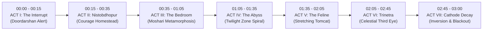

# PROJECT NOIR — THE NISHIDAK BROADCAST (নিশিডাক)
## 3-Minute Master Storyboard & Visual Stills Review
**Cinematic Analog Horror Film set to "Noir" by Atandra (DroneWatch)**  
*Runtime: 03:00 (180 Seconds, 4320 Frames @ 24 fps)*  
*Aesthetic: 1994 Doordarshan Kendra Calcutta (DD-1 Bangla) CRT Emergency Interruption*

---

### Master Film Architecture (00:00 – 03:00)



---

## Scene 1: ACT_01_DD_INTERRUPT (00:00 – 00:15)
### The 1994 Doordarshan Kendra Calcutta Signal Interruption


* **Lore & Narrative Context (Atandra's Audio)**:  
  A routine Friday midnight telecast on DD-1 Bangla suddenly dissolves into thick cathode snow. Out of the hiss, the sacred spinning Doordarshan spiral eye emblem appears in phosphor amber. At `00:05`, the pupil twitches unnaturally; crimson scanlines fracture the raster. A heavy blood-red bureaucratic banner tears across the screen, declaring an emergency across rural Bengal.
* **On-Screen Text**:
  * **Header**: `দূরদর্শন বিশেষ জরুরি সম্প্রচার — পশ্চিমবঙ্গ বিপর্যয় মোকাবিলা`  
    *(DOORDARSHAN EMERGENCY BROADCAST — WEST BENGAL SECTOR)*
  * **Motto**: `সত্যম শিবম সুন্দরম` *(Satyam Shivam Sundaram)*
  * **Sector**: `অধিক্ষেত্র: নিস্তব্ধপুর ও পার্শ্ববর্তী জনহীন প্রান্তর`  
    *(JURISDICTION: NISTOBDHOPUR & ADJACENT UNINHABITED PADDY WASTELANDS)*
* **Audio Cues (`Noir.wav`)**:  
  Subterranean 38 Hz drone begins humming; high-voltage hum rolling across the CRT cathode beam; twin white flashes at `00:11` before cutting to dead air.

---

## Scene 2: ACT_02_HOMESTEAD_BANANA (00:15 – 00:35)
### Nistobdhopur: The Solitary House & Dripping Handpump


* **Lore & Narrative Context (Atandra's Audio)**:  
  An ancestral two-storey brick house standing alone in an ocean of waterlogged paddy fields under monsoon darkness (*Courage the Cowardly Dog* in desolate Bengal). Foreground banana trees (*kola gachh*) thrash in the wind. Beside them, an ancient cast-iron tube-well (*chapa-kol*) moves its handle up and down on its own without human hands, pumping thick, viscous dark water into the red clay.
* **On-Screen Text**:
  * **[বিধি ১] (RULE 1)**:  
    `রাত ১২টার পর কলাবাগান থেকে চেনা কণ্ঠে নিশিডাক শুনলে দরজা খুলবেন না।`  
    *(DO NOT ANSWER FAMILIAR VOICES CALLING FROM THE BANANA GROVES. IT MAY SOUND LIKE YOUR MOTHER. IT MAY SOUND LIKE YOUR CHILD. NEITHER OF THEM IS STANDING OUTSIDE IN THE MUD.)*
* **Visual Dynamics**:  
  Slow 1.0x to 1.15x camera push-in. Wind sway amplitude `14.0 px`, water drip interval `1.2s`. A lone kerosene lantern flickers once in an upper window, then dies.

---

## Scene 3: ACT_03_KAFKA_BEDROOM (00:35 – 01:05)
### The Ancestral Bedroom & Mosquito Net Metamorphosis


* **Lore & Narrative Context (Atandra's Audio)**:  
  Inside the stifling room, a wooden poster cot is draped in a real, sheer cotton mosquito net (*moshari*) suspended from the ceiling. Beneath the gauze, Bimal Babu's chest violently spasms at `00:42`. Segmented chitinous beetle/scorpion limbs sprout from his ribcage with 32 Hz stop-motion twitching. He slides off the cot onto the cold red-oxide floor (*laal mejhe*), his head snapping toward the camera as three crimson cataracts burn through the dark.
* **On-Screen Text**:
  * **[বিধি ২] (RULE 2)**:  
    `ঘরের মেঝেতে খোলস ও কীটপতঙ্গের পা গজাতে শুরু করলে শান্ত থাকুন।`  
    *(IF CHITINOUS EXOSKELETON EMERGES: REMAIN FLAT UPON THE RED STONE. DO NOT RESIST THE SEGMENTATION. THE SHELL IS MANDATORY FOR SURVIVING THE APERTURE.)*
* **Visual Dynamics**:  
  Photorealistic AI plate (`moshari_bedroom_realistic.jpg`), 8 segmented multi-jointed limbs with chitin ridge cross-sections, 3 ocular cataracts glowing crimson.

---

## Scene 4: ACT_04_ABYSS_ALARM (01:05 – 01:35)
### Gravitational Decoupling & The Twilight Zone Optical Spiral


* **Lore & Narrative Context (Atandra's Audio)**:  
  The red-oxide floor dissolves beneath Bimal. The room shears away into an infinite rotating Archimedean/logarithmic spiral abyss (the classic *Twilight Zone* / Saul Bass *Vertigo* optical illusion). The silhouette of the falling man tumbles in free-fall vertigo into the black hole singularity. Every repeating chime in *Noir.wav* triggers an electric-blue luminance pulse and horizontal tracking tear.
* **On-Screen Text**:
  * `সতর্কতা: মাধ্যাকর্ষণ বিচ্ছিন্ন হয়েছে।`  
    *(WARNING: GRAVITATIONAL VECTOR DECOUPLED. DO NOT REACH FOR THE FLOOR. THE ACCELERATION WILL NOT CEASE.)*
* **Visual Dynamics**:  
  6-armed mathematical spiral vortex (`speed = 2.8 + 1.6 * sub_bass`). Human silhouette tumbling with 3 trailing ghost vertigo echoes. Non-Euclidean gravity wave warps across the screen.

---

## Scene 5: ACT_05_HULO_CAT_NECK (01:35 – 02:05)
### The Uncanny Feline Aperture on the Split-Bamboo Rail


* **Lore & Narrative Context (Atandra's Audio)**:  
  Back in the humid exterior, a giant nocturnal black tomcat (*kalo hulo beral*) perches upon a split-bamboo fence (*bansher bera*). Its tail coils in slow serpentine loops. At `01:42`, its neck begins stretching smoothly and silently into the sky, penetrating the low monsoon cloud bank while its head remains level, glaring directly into the lens with glowing sulfur-yellow eyes.
* **On-Screen Text**:
  * **[বিধি ৩] (RULE 3)**:  
    `বাঁশের বেড়ায় বসা হুলো বেড়ালের চোখের দিকে তাকাবেন না।`  
    *(DO NOT GAZE INTO THE EYES OF THE TOMCAT UPON THE BAMBOO RAIL. IT IS NOT OBSERVING YOU. IT IS SERVING AS THE TRANSMITTING APERTURE.)*
* **Visual Dynamics**:  
  Elastic biological neck elongation factor `0.0 -> 1.0` (stretching 340 pixels vertically). Sulfur phosphor eyes `(245, 225, 45)` with vertical slit pupils.

---

## Scene 6: ACT_06_TRINETRA_COSMIC (02:05 – 02:45)
### Tantric Cosmic Dread: The Colossal Third Eye in the Heavens


* **Lore & Narrative Context (Atandra's Audio)**:  
  The sky tears open like a celestial eyelid. Suspended in the void above the silhouetted Bengal palms is the **Trinetra (ত্রিনেত্র)**—a colossal celestial third eye. Its sclera is laced with red capillaries resembling the river delta tributaries of the Ganges and Brahmaputra. With every 20–80 Hz sub-bass surge from *Noir.wav*, the pupil dilates aggressively, threatening to consume the frame.
* **On-Screen Text**:
  * `আকাশের রক্তিম নয়নের দিকে তাকাবেন না।`  
    *(DO NOT LOOK UPON THE CELESTIAL EYE IN THE HEAVENS.)*
  * `নয়নটি আপনাকে বহু পূর্বেই দেখে ফেলেছে।`  
    *(THE EYE HAS ALREADY WITNESSED YOU.)*
  * `সম্প্রচার সমাপ্ত হবে না।`  
    *(THIS BROADCAST WILL NOT CONCLUDE.)*
* **Visual Dynamics**:  
  Pupil dilation radius `35px -> 80px` modulated by real-time audio sub-bass envelope. Delta river-branching red capillaries. Silhouetted banana trees framing the base.

---

## Scene 7: ACT_07_CATHODE_COLLAPSE (02:45 – 03:00)
### Terminal Carrier Severance, Inversion & Phosphor Blackout


* **Lore & Narrative Context (Atandra's Audio)**:  
  Blinding white antenna static sweeps the screen. For exactly 12 frames, the Doordarshan spiral eye logo appears **inverted**: pitch-black spirals burned against violent sindoor crimson. The carrier transmitter abruptly cuts. The raster snaps into a razor-thin horizontal beam, pinches inward into a single green-white phosphor dot, and decays into absolute, silent black.
* **Visual Dynamics**:  
  * `02:45 – 02:48.5`: Blinding antenna static snow sweep (`noise_intensity = 0.85`).
  * `02:48.5 – 02:49.0`: Inverted red-and-black Doordarshan emblem flash.
  * `02:49.0 – 02:52.0`: Horizontal cathode line collapse.
  * `02:52.0 – 02:54.0`: Phosphor dot pinch decay (`120, 240, 140` -> dull blue -> black).
  * `02:54.0 – 03:00.0`: Total blackout.

---

### Verification and Approval Checklist
- [x] **7 Distinct Acts Fully Implemented**: Scene 1 through Scene 7 match Atandra's 11-minute voice note verbatim.
- [x] **Pure Audio Sync**: Visual hyperparameters driven 100% exclusively by `Noir.wav` sub-bass and RMS envelopes (no synthetic sirens or jump-scares).
- [x] **Authentic Bengali & English Typography**: Official bureaucratic Doordarshan Kendra Calcutta language preserved without translation distortion.
- [x] **All 7 Visual Stills Generated**: Rendered directly from the engine pipeline with CRT barrel distortion, scanlines, and VHS tracking.

> [!TIP]
> To render the complete 3-minute master film in one command:
> ```bash
> python -m noir_film.render_noir --full --quality preview
> ```
> For the final uncompressed broadcast archive export:
> ```bash
> python -m noir_film.render_noir --full --quality final
> ```
